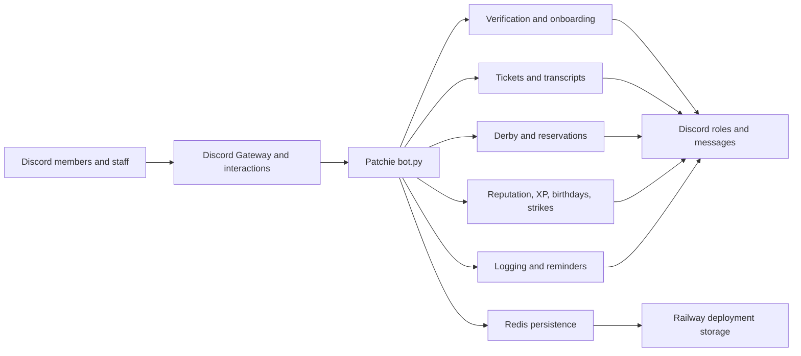

# Patchie — Discord Community Bot

### A live, community-driven Discord bot built for the Little Garden Hay Day community.

Patchie brings verification, tickets, moderation, trading reputation, derby coordination, leveling, birthdays, role management, logging, and scheduled announcements into one purpose-built Discord bot.

**Status:** Live and actively maintained · **Platform:** Discord · **Source:** Private

This repository is a public portfolio showcase only. The production bot, deployment configuration, credentials, private data, server identifiers, and source code remain private.

## The problem it solves

Little Garden is an active Hay Day community with multiple neighbourhoods, regular derbies, trading channels, events, applications, and staff workflows. As the community grew, many important tasks became repetitive or easy to miss:

- Reviewing member applications and assigning the correct roles
- Opening and managing support, hood, giveaway, and design tickets
- Preserving ticket history after ticket channels are closed
- Coordinating derby registration and task reservations
- Tracking safe trades and reputation milestones
- Keeping birthdays, strikes, self-roles, and activity systems up to date
- Logging deleted messages, edited messages, attachments, stickers, and server changes
- Posting reminders and time-sensitive announcements consistently

Patchie automates those workflows while keeping the community experience inside Discord. It gives staff practical tools for daily operations and gives members clear, self-service interactions through buttons, forms, dropdowns, reactions, and slash commands.

## What is implemented

### Member onboarding and community access

- Persistent verification button with a structured application form
- Questions for age confirmation, rule agreement, discovery source, birthday, and Hay Day farm tag
- Staff accept/deny workflow with persistent buttons that survive restarts
- Guest-role assignment after approval
- Welcome messages and Welcome Wagon role notifications
- Automatic birthday capture from accepted applications
- Join and leave notifications with invite attribution when Discord makes it available
- Leave-status reporting for unverified members, guests, and hood members
- Staff removal command that DMs the member with the stated reason before removal

### Tickets and transcripts

- Support tickets
- Hood-joining tickets
- Giveaway tickets
- Design-submission tickets
- Staff-created tickets for a selected member
- Private ticket permissions for the requester and staff
- Automatic staff and requester opening messages
- Giveaway requests that ask for prize, duration, winners, and participant scope
- Persistent transcript buttons
- Transcript storage that survives ticket-channel deletion
- Multi-page transcript embeds for long conversations
- Text-file fallback for transcripts that exceed Discord’s display limits
- Duplicate-ticket protection during overlapping interactions or deployments

### Moderation and audit logging

- Sour Berry strike system with reasons, timestamps, staff attribution, and 30-day expiry
- Automatic Sour Berry role synchronization
- Strike boards and strike-information posts
- Channel creation, deletion, renaming, and category-change logs
- Role creation, deletion, renaming, colour, and permission-change logs
- Batched member-role change logs to reduce noise
- Deleted-message and edited-message logging
- Deleted-message records include text, attachments, stickers, author, channel, and deletion source when Discord’s audit log identifies it
- Startup history hydration so older messages can still be available for later edit/delete logging
- Dedicated high-capacity caching for trading and reputation channels
- Intentional exclusions for the game’s `cat-bot` channel and Bot Playground channels

### Trading reputation

- Automatic recognition of `@member valid` messages in reputation channels
- Multiple validations allowed for separate successful trades
- Self-validation prevention
- Internal validation counting without noisy count messages
- Checkmark reaction confirmation on valid messages
- Reputation milestone roles at 5, 10, 15, 20, and 25 safe trades
- `/rep`, `/add_rep`, `/remove_rep`, and `/rep_leaderboard`
- `!ValidRules` information post

### Hoods and derby coordination

Patchie supports the Little Garden neighbourhood structure:

- Tangerine Fields
- Strawberry Patch
- Blueberry Garden
- Coconut Paradise

Implemented hood and derby workflows include:

- Hood information and recruitment announcements
- First-time, swap, and add workflows for hood roles
- Saturday derby registration posts for the participating hoods
- Accept, decline, and tentative registration buttons
- Automatic opt-in role assignment based on registration status
- Tuesday noon derby-start messages in each hood’s derby chat
- Hood-specific requirements for Normal, Power, Chill Bunny, Mystery, Blossom, and Bingo derbies
- Blueberry reservation tables with letter reactions
- Reservation lookup by task, member, or complete summary
- Reservation-thread binding and ping buttons
- Automatic weekly reservation cleanup
- Coconut Paradise role support without forced derby automation

### Leveling and activity

- XP gained from normal member messages
- Per-member cooldown to prevent message flooding from producing XP too quickly
- Persistent XP, level, and message-count tracking
- Garden-themed level titles and role assignment
- Automatic removal of outdated level roles when a member advances
- Level-up announcements
- `/level`, `/leaderboard`, and staff-only `/give_xp`

### Birthdays

- Automatic birthday capture from applications
- Manual birthday set/remove commands
- Persistent, self-updating birthday board
- Daily birthday greetings
- Separate birthday-list and birthday-ping channels
- Multi-message birthday boards when one embed is no longer large enough
- Automatic cleanup when members leave the server

### Self-roles and community utilities

- Persistent reaction-based self-role menus for:
  - Location
  - Pronouns
  - Age range
  - Community interests
  - Helper roles
- Community roles including Welcome Wagon, Event News, Giveaway, Game Night, Hayday News, and QOTD
- In-place self-role menu updates without deleting the existing messages
- Commerce Cats trading rules and role access through a checkmark reaction
- Personal reaction emojis when selected members are mentioned
- Giveaway and derby-helper reminders that replace older reminder posts
- Server rules, hood information, boost information, festival rules, staff introductions, and other announcement commands

## Selected commands

Patchie supports both traditional `!` commands and Discord slash commands.

| Area | Examples |
| --- | --- |
| Setup | `/setup_verify`, `/setup_tickets`, `/setup_selfroles`, `/update_selfroles` |
| Tickets | `/ticket open`, `/ticket close`, `/hoods` |
| Hoods | `/role`, `!Tangerine`, `!Strawberry`, `!Blueberry`, `!Coconut` |
| Derby | `/post_derby_registration`, `/test_derby_registration` |
| Reservations | `/post_task_table`, `/post_all_tables`, `/reserve`, `/task`, `/member`, `/summary`, `/clear` |
| Reputation | `/rep`, `/add_rep`, `/remove_rep`, `/rep_leaderboard`, `!ValidRules` |
| Leveling | `/level`, `/leaderboard`, `/give_xp` |
| Birthdays | `/post_birthdays`, `/birthday_set`, `/birthday_remove`, `/set_birthday_ping_channel` |
| Moderation | `/post_strikes`, `/strike_add`, `/strike_remove`, `/strike_clear`, `/strikes`, `/remove` |
| Community posts | `!rules`, `!aboutus`, `!Festival`, `!GiveawayRules`, `!TradeRules`, `!Submit`, `!staff` |

## Scheduled automations

Patchie includes timezone-aware scheduled jobs for recurring community operations:

- Birthday checks and greetings at 09:00 Europe/Copenhagen time
- Strike expiry and board refresh at 09:05 Europe/Copenhagen time
- Derby registration checks every minute, with Saturday posting after noon
- Derby-start checks every minute, with Tuesday posting after noon
- Reservation cleanup every Monday at 08:00 UTC
- Message-count reminders for giveaway and derby-helper channels

The derby scheduler uses frequent checks instead of relying on a single exact trigger. That allows it to catch up after a restart instead of silently missing an announcement, while keeping normal delivery close to the intended time.

## Technology

| Area | Technology and purpose |
| --- | --- |
| Language | Python 3.12 |
| Discord framework | `discord.py 2.3.2` |
| Discord features | Gateway events, slash commands, prefix commands, embeds, modals, buttons, dropdowns, reactions, roles, threads, audit logs, and permissions |
| Persistence | Redis-backed JSON-style data blobs |
| Local fallback | JSON files for development and Redis seeding |
| Atomic counters | Redis async increment for ticket numbering |
| Configuration | Environment variables loaded with `python-dotenv` |
| Scheduling | `discord.ext.tasks`, Python `datetime`, `zoneinfo`, and timezone data |
| Hosting | Railway worker deployment |
| Deployment command | `python -u bot.py` through a Railway `Procfile` |
| Media | Local PNG, WebP, and GIF assets used in Discord posts and embeds |

No external web service or public API is required for the core bot. Discord is the main platform integration, while Redis provides persistent production storage.

## How it works

Patchie is organized as a small Python application with feature modules, called cogs. The entry point loads the cogs, connects to Discord, synchronizes commands, and starts scheduled jobs.

Each cog listens for the Discord events or commands relevant to its feature. When a workflow changes persistent state—such as XP, reputation, birthdays, reservations, strikes, role-menu mappings, or transcripts—the data is passed through a shared storage layer. Redis is preferred in production so the data survives Railway redeployments; local JSON files provide a development fallback.

Persistent Discord views are re-registered after restarts. This is what allows old application buttons, ticket buttons, transcript buttons, and derby-registration controls to keep working after Patchie has been redeployed.

## Community-driven development

Patchie is developed around real operational needs rather than a fixed demo feature list.

The development cycle is:

1. A member or staff workflow becomes repetitive, unclear, or difficult to manage.
2. The requirement is defined in terms of what the community should experience.
3. A Discord-native solution is designed using commands, forms, buttons, reactions, roles, embeds, or scheduled jobs.
4. The feature is implemented and deployed without exposing private community data.
5. The feature is tested through real day-to-day use.
6. Problems discovered in live usage are fixed, simplified, or made more reliable.

This process has led to improvements such as persistent views after restarts, transcript fallbacks, multi-message birthday boards, startup message-cache hydration, duplicate-ticket protection, self-updating role menus, and catch-up behavior for scheduled derby announcements.

## My role in the project

I am the creator and project owner of Patchie. I am responsible for:

- Identifying needs from members and staff
- Defining requirements and deciding how workflows should behave
- Designing the user experience inside Discord
- Choosing priorities and deciding which automations are worth maintaining
- Reviewing and directing implementation changes
- Testing features in the real Little Garden community
- Diagnosing failures and improving reliability over time
- Maintaining the bot, deployment, content, permissions, and stored-data workflows

The project uses AI-assisted coding. AI tools have contributed to implementation, refactoring, debugging, and technical investigation under my direction. I remain responsible for the product decisions, requirements, acceptance criteria, review of the resulting behavior, testing in everyday use, and ongoing maintenance. This is not presented as a project where every line was manually written without assistance, nor as a project that required no engineering ownership.

## Current status

| State | Scope |
| --- | --- |
| **Live** | Patchie is actively used by the Little Garden Discord community. |
| **Implemented** | Verification, tickets, transcripts, moderation, reputation, hood management, derby coordination, reservations, leveling, birthdays, self-roles, logging, reminders, and scheduled announcements. |
| **Continuously maintained** | Features are updated as community workflows and staff needs change. |
| **Not included here** | Bot source code, credentials, private logs, server identifiers, member data, and deployment secrets. |
| **Testing reality** | The primary validation environment is the live community and targeted manual verification. There is currently no automated test suite. |

The project is functional and in active use, but it is intentionally tailored to Little Garden. Many roles and channels are located using configured names or name patterns, so the bot is not currently a plug-and-play general-purpose package for arbitrary Discord servers.

Other practical limitations include Discord permission requirements, Discord API rate limits, best-effort invite attribution, and the need for Redis in production if persistent data must survive container replacement.

## Source availability

This repository is a public portfolio showcase only. The actual Patchie repository remains private because it contains server-specific implementation details, configuration assumptions, private operational data, and deployment-sensitive information.

The goal of this showcase is to demonstrate the product thinking and engineering work behind a live community tool: identifying real user needs, designing practical workflows, integrating with Discord, shipping improvements, and maintaining software that people use every day.
